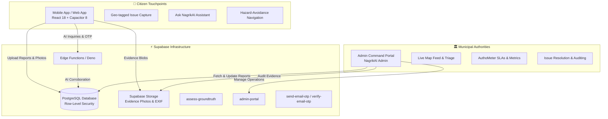

# NagrikAI 🇮🇳

> **Your City. Your Voice. Your Intelligence.**  
> An AI-powered civic-tech ecosystem bridging citizens and municipal authorities through ground-truth verification, real-time incident mapping, and city-aware intelligence.

[](https://react.dev/)
[](https://vitejs.dev/)
[](https://capacitorjs.com/)
[](https://supabase.com/)
[](https://leafletjs.com/)
[](LICENSE)

---

## 📌 Table of Contents

- [Overview](#-overview)
- [System Architecture](#-system-architecture)
- [Key Modules](#-key-modules)
  - [1. NagrikAI Citizen App (Frontend)](#1-nagrikai-citizen-app-nagrikai-frontend)
  - [2. Municipal Administration Portal (Admin)](#2-municipal-administration-portal-nagrikai-admin)
  - [3. Supabase Backend & Edge AI](#3-supabase-backend--edge-functions)
- [Technology Stack](#-technology-stack)
- [Project Directory Structure](#-project-directory-structure)
- [Getting Started](#-getting-started)
  - [Prerequisites](#prerequisites)
  - [Environment Configuration](#environment-configuration)
  - [Running the Citizen App](#running-the-citizen-app)
  - [Running the Admin Portal](#running-the-admin-portal)
  - [Deploying Supabase Edge Functions](#deploying-supabase-edge-functions)
- [Mobile Build (Android / Capacitor)](#-mobile-build-android--capacitor)
- [Civic Intelligence & Algorithms](#-civic-intelligence--algorithms)
- [License](#-license)

---

## 🌆 Overview

**NagrikAI** is an end-to-end civic accountability and urban intelligence platform tailored for Indian municipal ecosystems (with initial modeling for **Greater Noida** and the National Capital Region). 

Citizens often encounter disconnected municipal feedback loops: potholes remain open, waterlogging recurrences go unmonitored, and work claims are marked "resolved" without transparent verification. NagrikAI solves this by combining:
1. **GroundTruth AI**: Automated computer vision & multi-angle corroboration comparing "before" damage reports against "after" repair claims.
2. **Citizen Mobile Experience**: 30+ responsive screens featuring geo-tagged issue capture, bilingual AI assistants, real-time hazard navigation, and official CPCB-grade AQI calculation.
3. **Municipal Command Portal**: Real-time triage dashboard featuring the **AuthoMeter** (departmental resolution benchmarking) and AI audit workflows.

---

## 🏗️ System Architecture



---

## 🚀 Key Modules

### 1. NagrikAI Citizen App (`nagrikai-frontend`)
- **Frictionless Onboarding**: Passwordless authentication via Email / SMS OTP backed by Supabase Auth with demo fallback mode.
- **Civic Issue Capture**: GPS auto-tagging, EXIF location extraction via `exifreader`, photo capture, category classification (*Roads, Water, Waste, Street lighting*), and severity scoring.
- **Duplicate Detection**: Spatial proximity checks flag similar community reports to reduce redundant submissions.
- **GroundTruth AI Inspection**: Visual side-by-side comparison of pre-repair and post-repair states with repair probability confidence ratings.
- **Explore Map & Civic Navigation**: Leaflet-based interactive map with custom intelligence filters (*Traffic flow, Issue density heatmaps, Predicted waterlogging*) and dynamic route suggestions that route around road hazards.
- **Weather & CPCB Air Quality**: Live meteorological forecasts paired with accurate Indian Central Pollution Control Board (CPCB) breakpoint calculation across $PM_{2.5}$, $PM_{10}$, $NO_2$, and $SO_2$.
- **City AI & Voice Assistant**: Multilingual city intelligence bot with persisted chat sessions and speech recognition integration.
- **Bilingual Engine**: Real-time English ↔ Hindi (`हिन्दी`) translation with accessibility controls (high contrast, reduced motion).

### 2. Municipal Administration Portal (`nagrikai-admin`)
- **Live Display View**: High-level geographic monitor tracking active complaints, clusters, and priority breakdowns.
- **AuthoMeter**: Department performance analytics measuring median resolution duration, backlog ratios, and authority responsiveness.
- **Issue Fixed View**: Verification console allowing field engineers to upload fix proof and dispatch community re-check verifications.
- **AI Municipal Assistant**: Automated query resolution and report summarization for civic administrators.

### 3. Supabase Backend & Edge Functions (`supabase/`)
- **PostgreSQL Schemas & Migrations**: Complete relational schema with RLS security policies covering `reports`, `evidence`, `community_corroborations`, `authorities`, and `audit_trails`.
- **`assess-groundtruth`**: Deno edge function evaluating photo similarity, fill quality, and evidence corroboration.
- **`admin-portal`**: Secured API for administrative actions, analytics querying, and status dispatch.
- **`send-email-otp` & `verify-email-otp`**: Robust passwordless verification flow with rate limiting.

---

## 💻 Technology Stack

| Layer | Technologies |
|---|---|
| **Frontend Framework** | React 18, Vite 6, Lucide Icons |
| **Mobile Runtime** | Capacitor 8 (Android) |
| **Mapping & GIS** | Leaflet, React-Leaflet, BigDataCloud Reverse Geocoding |
| **State & Storage** | React Hooks, Supabase Storage, Web LocalStorage |
| **Backend & Database** | Supabase (PostgreSQL, PostGIS, Row Level Security) |
| **Serverless Functions** | Deno TypeScript (Supabase Edge Functions) |
| **External APIs** | Open-Meteo API (Weather & AQI), MyMemory Translation API |
| **Image Processing** | ExifReader (Metadata & Geolocation extraction) |

---

## 📁 Project Directory Structure

```text
NagrikAI/
├── nagrikai-frontend/           # Citizen mobile & web application
│   ├── android/                 # Native Android Capacitor wrapper
│   ├── public/                  # Static assets & icons
│   ├── src/
│   │   ├── App.jsx              # Main application shell & 30-screen router
│   │   ├── AskAIScreen.jsx      # City AI conversational screen
│   │   ├── AskAIConversations.jsx # Multi-session chat history
│   │   ├── GroundTruthScreens.jsx # Evidence review & repair verification UI
│   │   ├── groundtruthService.js # Business logic for reports & corroboration
│   │   ├── WeatherSky.jsx       # Dynamic weather & ambient sky rendering
│   │   ├── LocationPicker.jsx   # Interactive map pin selection
│   │   ├── translations.js      # English ↔ Hindi DOM translation dictionary
│   │   └── supabaseClient.js    # Supabase initialization & offline fallback
│   ├── capacitor.config.json    # Capacitor configuration (App ID: com.nagrikai.app)
│   ├── vite.config.js           # Vite build pipeline
│   └── package.json
│
├── nagrikai-admin/              # Authority / municipal command portal
│   ├── src/
│   │   ├── App.jsx              # Admin application layout
│   │   ├── adminService.js      # Admin API connector
│   │   └── components/
│   │       ├── LiveDisplayView.jsx   # Live incident feed & map
│   │       ├── AuthoMeterView.jsx    # Departmental SLA benchmarking
│   │       ├── IssueFixedView.jsx    # Resolution validation workflow
│   │       └── AiAssistantView.jsx   # Administrative AI Copilot
│   ├── vite.config.js
│   └── package.json
│
├── supabase/                    # Backend migrations & Edge Functions
│   ├── functions/               # Deno Edge Functions
│   │   ├── assess-groundtruth/  # AI repair verification
│   │   ├── admin-portal/        # Authority management API
│   │   ├── send-email-otp/      # OTP dispatch
│   │   └── verify-email-otp/    # OTP validation
│   └── migrations/              # SQL schemas & RLS security rules
│
├── .env.example                 # Environment variable templates
└── README.md                    # Project documentation
```

---

## 🛠️ Getting Started

### Prerequisites
- **Node.js**: v18.0.0 or higher
- **npm** or **pnpm**
- **Android Studio** (optional, for native Android compilation)
- **Supabase CLI** (optional, for local Edge Function testing)

### Environment Configuration

Create a `.env` file in `nagrikai-frontend/` (and `nagrikai-admin/`):

```bash
# nagrikai-frontend/.env
VITE_SUPABASE_URL=https://your-project-id.supabase.co
VITE_SUPABASE_PUBLISHABLE_KEY=your-anon-key
```

*(Note: The app contains built-in offline/demo fallbacks if Supabase keys are not supplied during local UI development).*

### Running the Citizen App

```bash
cd nagrikai-frontend
npm install
npm run dev
```
The application will launch on `http://localhost:5173/` (or the next available port).

### Running the Admin Portal

```bash
cd nagrikai-admin
npm install
npm run dev
```
The admin console will start on `http://localhost:5174/`.

### Deploying Supabase Edge Functions

```bash
supabase login
supabase link --project-ref your-project-id
supabase functions deploy assess-groundtruth
supabase functions deploy admin-portal
```

---

## 📱 Mobile Build (Android / Capacitor)

NagrikAI is packaged for Android using Capacitor 8:

1. Build the production web bundle:
   ```bash
   cd nagrikai-frontend
   npm run build
   ```

2. Copy the web assets to the native Android directory:
   ```bash
   npx cap copy android
   ```

3. Open and run the project in Android Studio:
   ```bash
   npx cap open android
   ```

---

## 🔬 Civic Intelligence & Algorithms

### Central Pollution Control Board (CPCB) AQI Engine
The application calculates real-time AQI directly from hourly pollutant concentrations ($PM_{2.5}$, $PM_{10}$, $NO_2$, $SO_2$) against official Indian CPCB sub-index breakpoints:

$$\text{Sub-Index} = \frac{I_{HI} - I_{LO}}{B_{HI} - B_{LO}} \cdot (C_p - B_{LO}) + I_{LO}$$

Where:
- $C_p$ is the pollutant concentration
- $[B_{LO}, B_{HI}]$ represents breakpoint concentration ranges
- $[I_{LO}, I_{HI}]$ represents corresponding AQI sub-index ranges
- The overall **AQI** is taken as $\max(\text{Sub-Index}_i)$ with categories from **Good (0–50)** to **Severe (401–500)**.

---

## 📄 License

This project is licensed under the [MIT License](LICENSE).

---

<div align="center">
  <sub>Built for the citizens and administrators of Greater Noida & NCR. Empowering transparent, verified civic progress.</sub>
</div>
